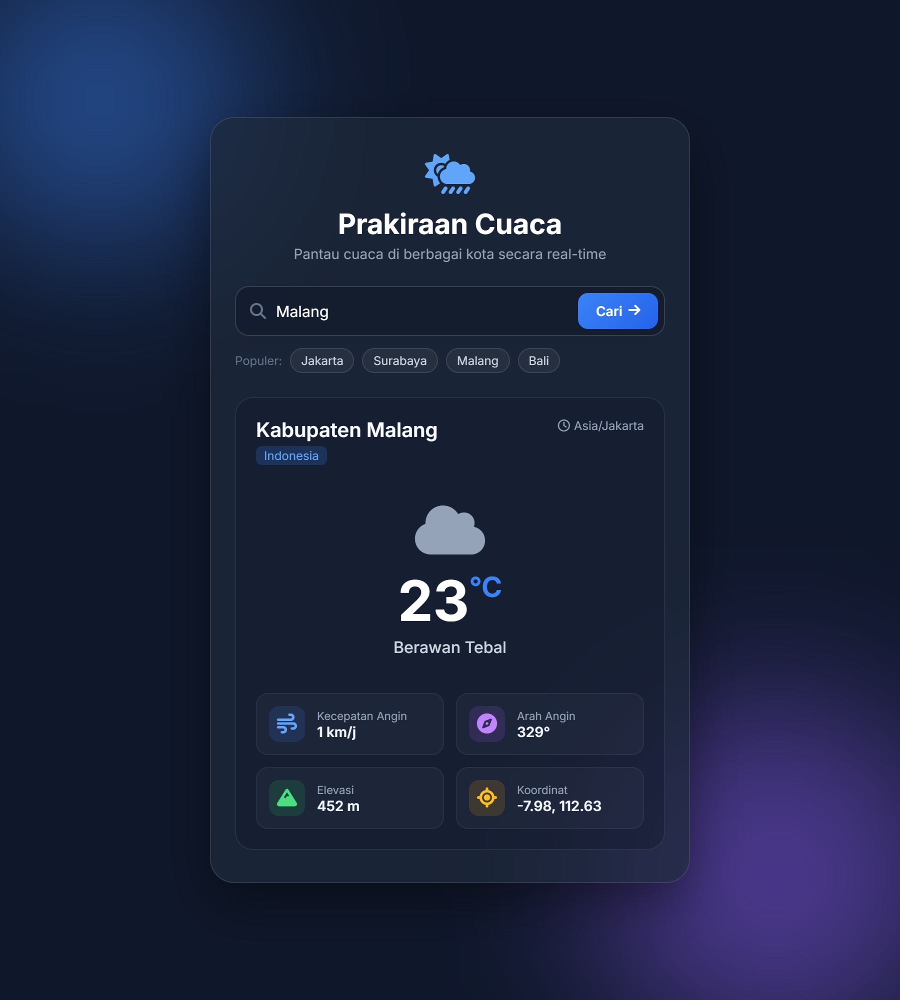

# AppCuaca

Aplikasi cuaca sederhana berbasis HTML, CSS, dan JavaScript murni (tanpa framework) yang menampilkan informasi cuaca real-time untuk kota mana pun di dunia. Data diambil langsung dari API publik [Open-Meteo](https://open-meteo.com/) tanpa memerlukan API key.



## Fitur

- Pencarian cuaca berdasarkan nama kota (mendukung bahasa Indonesia).
- Tombol kota populer: Jakarta, Surabaya, Malang, dan Bali.
- Pencarian dengan menekan tombol **Cari** atau tombol **Enter**.
- Menampilkan:
  - Nama kota dan negara
  - Zona waktu
  - Suhu (°C)
  - Kondisi cuaca beserta ikon dan warna
  - Kecepatan dan arah angin
  - Elevasi lokasi
  - Koordinat (latitude, longitude)
- Indikator loading saat mengambil data.
- Pesan error jika kota tidak ditemukan atau koneksi gagal.
- Desain dark theme dengan efek glassmorphism dan background gradient.

## Teknologi

- **HTML5** — struktur halaman (`index.html`)
- **CSS3** — styling, layout, animasi, responsive (`style.css`)
- **JavaScript (ES6+)** — logika aplikasi dan konsumsi API (`script.js`)
- **Font Awesome 6** — ikon cuaca
- **Google Fonts (Inter)** — tipografi

## API yang Digunakan

1. **Open-Meteo Geocoding API**
   ```
   https://geocoding-api.open-meteo.com/v1/search?name={kota}&count=1&language=id
   ```
   Digunakan untuk mengubah nama kota menjadi koordinat (latitude/longitude), negara, elevasi, dan zona waktu.

2. **Open-Meteo Forecast API**
   ```
   https://api.open-meteo.com/v1/forecast?latitude={lat}&longitude={lon}&current_weather=true
   ```
   Digunakan untuk mengambil data cuaca terkini (suhu, kode cuaca, kecepatan, dan arah angin).

Keduanya gratis, tanpa API key, dan diakses menggunakan `fetch()` di `script.js`.

## Struktur Folder

```
AppCuaca/
├── index.html      # Struktur UI
├── style.css       # Styling dan animasi
├── script.js       # Logika pencarian dan konsumsi API
├── screenshot.png  # Tangkapan layar aplikasi
└── README.md       # Dokumentasi ini
```

## Cara Menjalankan

1. Download/clone folder ini.
2. Buka `index.html` langsung di browser (Chrome, Edge, Firefox, dll).
3. Ketik nama kota pada kolom pencarian, lalu tekan **Cari** atau **Enter**.

Tidak diperlukan instalasi, build tool, server, atau API key. Koneksi internet diperlukan untuk mengambil data cuaca dan memuat font/ikon dari CDN.

## Pemetaan Kode Cuaca

| Kode | Kondisi | Contoh Ikon |
|------|---------|-------------|
| 0 | Cerah | `fa-sun` |
| 1–2 | Cerah Berawan | `fa-cloud-sun` |
| 3 | Berawan Tebal | `fa-cloud` |
| 45–48 | Berkabut | `fa-smog` |
| 51–55 | Gerimis | `fa-cloud-rain` |
| 61–63 | Hujan Sedang | `fa-cloud-showers-heavy` |
| 65 | Hujan Lebat | `fa-cloud-bounce` |
| 95–99 | Badai Petir | `fa-cloud-bolt` |

Pemetaan ini ditangani oleh fungsi `getWeatherMeta()` pada `script.js`.
